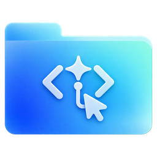
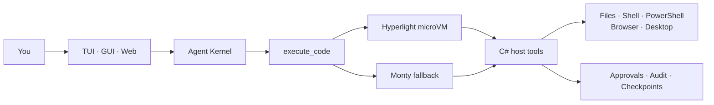
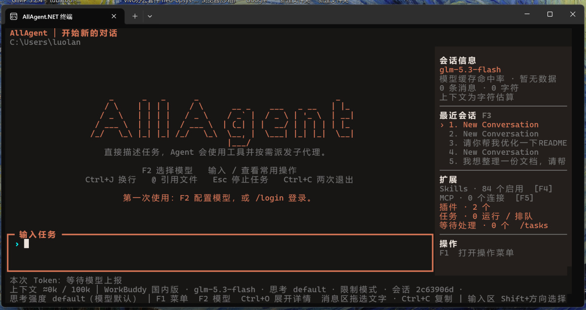
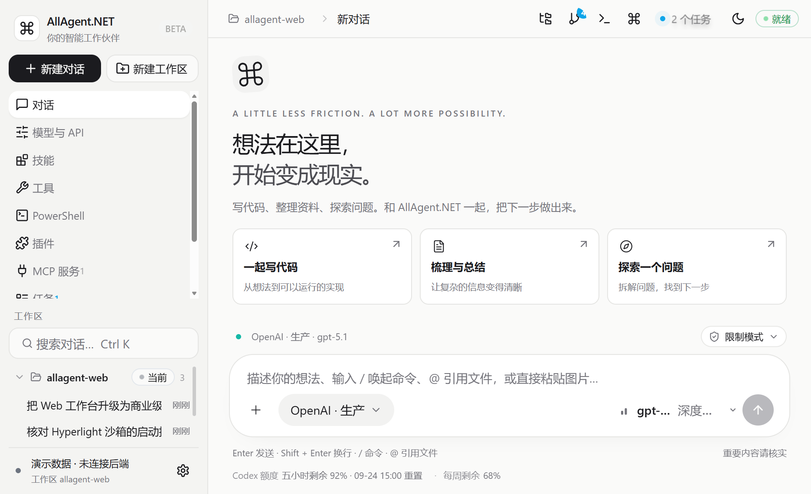
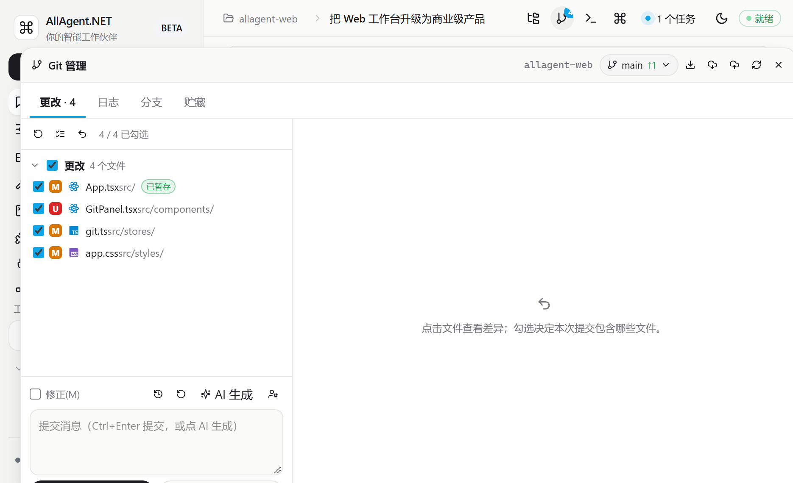

<div align="center">



# AllAgent.NET

**A Windows-native AI agent that stops fighting PowerShell.**

CodeAct · Windows Computer Use · bundled PowerShell 7.6 · TUI + GUI

[](https://github.com/luolangaga/AllAgent.NET/releases/latest)
[](https://www.nuget.org/packages/AllAgent.NET.Terminal)
[](https://www.nuget.org/packages/AllAgent.NET.Terminal)
[](https://github.com/luolangaga/AllAgent.NET/stargazers)
[](https://github.com/luolangaga/AllAgent.NET/issues)
[](#requirements)
[](#build-from-source)
[](LICENSE)
[](#the-comparison)
[](#the-comparison)

**English** · [简体中文](README.zh-CN.md)

</div>

---

## AI is fighting PowerShell again

Ask a traditional agent to do something real on Windows and it will often emit a 100-line PowerShell script. It mixes `cmd` and PowerShell syntax, forgets `-ErrorAction`, quotes a path with spaces incorrectly, or trips over encoding. Then it retries with another giant script. Every retry costs time and tokens.

The same agents usually have three more problems:

- **No native Computer Use on Windows.** They stop at the shell, or rely on fragile Python automation.
- **A heavy runtime before the first task.** Electron/Node agents bundle Chromium and Node; Python-based agents add another interpreter.
- **One JSON tool call per step.** A complex task becomes a long chain of model round trips.

AllAgent.NET was built to remove these four problems. It is a .NET agent for real Windows workflows: CodeAct orchestration, native Computer Use, a bundled PowerShell 7.6 environment, and a TUI plus GUI that share the same kernel.

## The comparison

| Problem | Traditional tool-calling agent | AllAgent.NET |
|---|---|---|
| **Complex Windows task** | Model writes a long PowerShell script; quoting and encoding errors; retries | Model writes one Python CodeAct program; typed host tools do the Windows work |
| **Complex task cost** | One JSON tool call per step; many model round trips | One orchestration program; fewer round trips and fewer tokens |
| **Windows automation** | Often none, or Python `pyautogui` / `uiautomation` | 12 `computer_*` tools on FlaUI / UIA3, plus browser control |
| **PowerShell** | `powershell.exe -Command "..."` strings; encoding problems | In-process .NET + bundled PowerShell 7.6 SDK; typed objects |
| **Runtime footprint** | Electron/Node + Python + bundled Chromium | .NET host + system WebView2 + one shared runtime |
| **UI** | Chat only, or an IDE plugin | TUI, GUI, and Web workbench share one kernel |
| **Git and terminal** | Separate apps | Built-in Git panel and integrated terminal |
| **Extensibility** | MCP/tools with their own auth and config | .NET plugins, distributed as NuGet packages |

## Seven advantages

### 1. CodeAct: one Python program instead of a chain of JSON tool calls

A normal agent calls tools through JSON. If you ask it to read a file, analyze the content, and save the result, it may need three or more tool calls — and three or more model round trips.

With CodeAct, the model writes one Python program that performs the whole sequence. The program does not need to be a long PowerShell script, and it does not need Git Bash or a POSIX shell to make the script work. It calls typed host tools for the actual Windows operations: read the file, run the command, write the result. The model handles the orchestration; the host handles the side effects.

```
Model → execute_code (Python orchestration) → host tools (C#) → Windows
```

This is the main reason CodeAct exists:

- **It stops the model from writing complex PowerShell.** The model no longer has to produce a fragile 100-line script with quoting, encoding, and `cmd`/PowerShell syntax mixed together. The host tool receives paths and arguments as data.
- **It reduces token consumption on complex tasks.** There is no repeated JSON tool-call envelope, no giant PowerShell script in the prompt or response, and fewer retries caused by quoting errors.
- **It keeps one permission boundary.** Every side effect still passes through a typed C# host tool, so approvals, path rules, and audit are not scattered across tools.

### 2. Windows Computer Use and browser control

Most agents on Windows stop at the shell. Native desktop automation is missing because it needs UIA/FlaUI integration, window and session management, and per-action approvals — not just another Python package.

AllAgent.NET includes it:

- **12 `computer_*` tools** built on FlaUI / UIA3.
- **Three modes**: `background` (UIA semantic actions, no focus), `foreground` (physical keyboard and mouse), and `isolated` (a separate Windows session worker).
- **Browser control**: embedded WebView2 or external Chrome/Edge, implemented in C#. No Python browser library and no extra Chromium download.
- **Approval and audit**: desktop actions still go through the same host gateway.

### 3. A real PowerShell 7.6 environment, hosted by .NET

PowerShell and this app are both .NET. That is not a coincidence:

- The app ships a bundled, nearly complete PowerShell 7.6.x environment, including its modules. You do not need a system PowerShell installation, and it does not fall back to PowerShell 5.1.
- The PowerShell worker hosts the engine directly in a .NET process through `System.Management.Automation` and a runspace. Paths, arguments, and results stay typed objects. Nothing is re-encoded through `powershell.exe -Command "..."`, so the classic quoting and encoding failures disappear.
- `powershell_script` runs in named persistent sessions. Variables, functions, imports, and the working directory survive between calls.
- The PowerShell management page can search PowerShell Gallery, install modules, and inspect validated exported commands.

This is the difference between "call a PowerShell process and hope the string survives" and "host the PowerShell engine and exchange typed objects."

### 4. Beginner-friendly TUI and GUI, installed together

You do not choose between a terminal and a desktop app:

- **TUI**: full-screen terminal, F1 common actions, F2 model picker, F3 sessions, Ctrl+P command search, approval cards, plan mode, and background sessions.
- **GUI**: a native WPF + WebView2 window with the same workspace, sessions, permissions, and background tasks.
- **One installer**: the Windows installer ships both and can create both shortcuts.
- **Same data**: closing the window ends the host; the terminal and GUI read the same workspace data.

### 5. Multiple providers

The provider layer supports:

- OpenAI Chat / Responses
- Anthropic
- Gemini
- Ollama
- OpenAI-compatible services

Provider presets and OpenAI-compatible endpoints cover services such as CommandCode, Codex, and DeepSeek. Press F2 or use `/providers` and `/model` to switch; the terminal remembers the last choice.

### 6. Git and terminal integration

The GUI/Web workbench is not just a chat page:

- **Workspace files**: browse and preview files, then reference them in the conversation.
- **Git management**: staging, commits, branches, commit graph, stash, push/pull, and AI-generated commit messages.
- **Integrated terminal**: ConPTY + xterm.js, multiple tabs, and a session that survives a page refresh.
- **TUI equivalents**: `/diff`, `/undo`, `/redo`, `/checkpoints`, and `@file` references.

### 7. Plugin extensibility

Plugins are .NET packages, not a separate scripting layer:

- Register tools with `[AgentTool]` and `[Description]`.
- Extend the Web workbench through the plugin `web` block: pages, custom tool cards, and command-palette entries in a sandboxed iframe.
- Publish plugins to NuGet or install them from the plugin manager.
- Built-in examples include CommandCode, GitHub, WorkBuddy, CodeGraph, and Qoder.

## Why .NET, not Electron or Node

The .NET choice is not cosmetic. It is the reason the runtime is smaller and the PowerShell integration is cleaner.

| Concern | Electron/Node agent | AllAgent.NET |
|---|---|---|
| **UI runtime** | Bundled Chromium + Node | .NET host + system WebView2 |
| **Agent host** | Node process | .NET process |
| **Workers** | Separate runtimes and processes | Host and workers share one self-contained .NET runtime |
| **PowerShell** | Subprocess and command strings | In-process `System.Management.Automation` + runspace |
| **Windows APIs** | FFI / native addons | Direct C# / Win32 / COM / UIA |
| **Deployment** | Ship Chromium, Node, and app | Ship one self-contained output directory |

What this means in practice:

- **Lower memory baseline.** There is no bundled Chromium and no Node runtime in the agent host. The GUI uses the system WebView2 runtime, and the host and workers share one .NET runtime instead of starting a new stack for every component.
- **No PowerShell encoding roulette.** The PowerShell engine is hosted inside the .NET worker. Arguments are passed as objects, not concatenated into a command line, so paths with spaces, Unicode, and quotes do not get re-parsed by a shell.
- **Native Windows access.** C# can call Win32, COM, UIA, WebView2, and process/job APIs directly. The same language is used for the host tools, workers, and GUI shell.
- **Self-contained deployment.** The terminal host, GUI, browser, sandbox, PowerShell, and desktop workers live in one output directory and share one runtime.

Python is still used for the execution environment (3.10–3.14), but it is not the agent host. The point is to avoid stacking Electron + Node + Python + a bundled browser before the first task.

## Architecture



- **Agent Kernel**: Microsoft Agent Framework drives the loop, the per-call authorization gateway, the cross-surface session runtime, and scoped sub-agent handoff.
- **CodeAct**: the CodeAct execution path exposes only `execute_code` to the model.
- **Sandbox**: Hyperlight first, Monty fallback, execution blocked when neither is available.
- **Host tools**: 30+ `[AgentTool]` implementations covering files, search, shell, PowerShell, browser, desktop, tasks, and plans.
- **Data layer**: `DataStore` is the only history writer; atomic replacement, fsync, checksum read-back, and cross-process transactions.

## Screenshots

### TUI



*Full-screen TUI: welcome screen, recent conversations, extension status, and the composer in one terminal. Chat, approvals, plans, and background sessions stay in the same view.*

### GUI workbench



*GUI workbench (demo data): workspace, model configuration, conversation list, permission mode, task status, and composer in one window.*

### GUI Git management



*Git management (demo data): staging, commits, branches, commit graph, stash, push/pull, and AI-generated commit messages.*

> The screenshots show the current Chinese UI. "Demo data" means the page is rendered through the built-in mock transport to show layout and interaction; connect a local host to see real workspace data. The TUI image shows the actual running interface.

## Quick start

### Requirements

| Item | Requirement |
|---|---|
| OS | Windows x64 / ARM64 (agent execution is Windows-only; ARM64 falls back to Monty when Hyperlight is unavailable) |
| .NET | .NET 10 SDK for source builds; .NET 10 or newer at runtime |
| Python | Optional; only the Monty fallback sandbox needs 3.10–3.14 for its first setup, and Hyperlight needs none |
| Virtualization | Hyperlight needs hardware virtualization and Windows Hypervisor Platform; without it, Monty is used automatically |
| PowerShell | Not required separately; PowerShell SDK 7.6.x is bundled and runs in its own worker |
| ripgrep | Required for content search; `allagent doctor --install` can install it |
| Node.js / npm | Only needed to build the React frontend |
| GUI | Microsoft Edge WebView2 Runtime for the native window |

### Install

**Windows installer (recommended)**: download the installer for your architecture from [Releases](https://github.com/luolangaga/AllAgent.NET/releases): `AllAgent.NET-<version>-win-x64-setup.exe` or `AllAgent.NET-<version>-win-arm64-setup.exe`. The installer can create "Terminal" and "Desktop" shortcuts and install WebView2 and ripgrep. It is self-contained; no .NET runtime is required. See [Windows installer](docs/windows-installer.zh-CN.md).

**Install as a .NET Tool**:

```powershell
# Windows x64
dotnet tool install --global AllAgent.NET.Terminal

# Windows on ARM (the command is still allagent)
dotnet tool install --global AllAgent.NET.Terminal.arm64

allagent --help
allagent doctor
```

Upgrade or uninstall:

```powershell
dotnet tool update --global AllAgent.NET.Terminal
dotnet tool uninstall --global AllAgent.NET.Terminal

# Windows on ARM
dotnet tool update --global AllAgent.NET.Terminal.arm64
dotnet tool uninstall --global AllAgent.NET.Terminal.arm64
```

The built-in updater works for tool installs too:

```powershell
allagent update --check
allagent update
```

For local NuGet packaging and installation, see [.NET Tool packaging](docs/nuget-tool.zh-CN.md). For building the EXE installer locally, see [Windows installer](docs/windows-installer.zh-CN.md).

### First run

```powershell
allagent chat --workspace C:\Projects\MyProject
```

The first chat initializes the environment: the bundled PowerShell SDK worker and ripgrep are checked, and host Python is no longer required up front — it is resolved only when the Monty fallback sandbox is used. Model and extension management do not start the sandbox; the execution environment is validated on the first task. Use `--no-initialize` when offline or when you only want to change configuration.

### Configure a model

In chat, press **F2** to choose a provider and model, or use `login` for a supported account. `/providers edit <name>` edits the endpoint, key, protocol, and parameters; `/model` switches at any time. The terminal remembers your last choice.

You can also configure temporarily with environment variables, keeping the API key out of the project:

```powershell
$env:ALLAGENT_PROVIDER = 'openai'
$env:ALLAGENT_BASE_URL = 'https://api.openai.com/v1'
$env:ALLAGENT_MODEL = '<model id>'
$env:ALLAGENT_API_KEY = '<your API key>'
allagent chat --workspace C:\Projects\MyProject
```

### GUI and Web workbench

| Entry | Behavior |
|---|---|
| `allagent -guimode` | Validates arguments, spawns a hidden host, and returns immediately; closing the window ends it |
| `allagent gui` | Runs the same window in the foreground; Ctrl+C exits. `--gui-url` points at a Vite dev server; `--gui-devtools` opens in-window developer tools |
| `/web-ui` in chat (or `allagent web-ui`) | Opens the Web workbench in a browser, sharing workspace, model configuration, permissions, and background tasks with the terminal |

```powershell
allagent -guimode
allagent gui --gui-url http://127.0.0.1:5173/
allagent web-ui
allagent web-ui --lan --port 8765 --password your-password
allagent web-ui --no-lan
```

Use `--lan` (or `/web-ui --lan` in chat) when a phone or tablet should connect: the host listens on `0.0.0.0`, prints a QR code in the terminal, and other devices can enter by scanning it. This machine never needs a password; other devices use the per-run QR token, and a configured access password also works (external pages always show the password field). The token expires when the service restarts. `--no-lan` (or `--local`) turns LAN listening off and remembers the choice so the next start stays on loopback; the Web settings page exposes the same switch, port, password, and QR code. Windows Firewall may ask for permission the first time; allow private networks.

The window is a bundled WPF + WebView2 shell (`AllAgent.NET.Gui.exe`), with one window per data directory. Its pages cover chat, models and APIs, skills, tools, PowerShell, plugins, MCP servers, tasks, and settings. The PowerShell page shares its module directory with the terminal's `/powershell` panel.

## Permission modes and security boundaries

| Mode | Behavior |
|---|---|
| **restricted (default)** | File reads/writes inside the workspace and trusted shell aliases (`git`, `rg`, `dotnet`, `node`, `npm`, and more via `--allow-shell`) run directly. Paths outside the workspace, untrusted programs, and MCP / desktop / plugin tools still require per-call approval |
| **full** | Host tools generally no longer require per-call approval and may access paths outside the workspace. Sandbox isolation still applies; administrator rights are never granted |
| **ask** | Per-call approval, including writes inside the workspace. The approval card defaults to "allow this time": `Enter` confirms, `Y` allows, `N` or `Esc` rejects, and `A` remembers the directory |
| **plan** | Read-only investigation. The model submits a Markdown plan through `plan_propose`; the TUI shows Markdown and the Web shows an HTML approval card. The card accepts a comment or suggested change: submitting it keeps plan mode and the model revises the plan, while an approved plan carries the comment into execution. Plan text follows the interface language. Approval switches to full access and starts execution in the same turn; rejection continues revision |
| **simple** | Only `powershell_script`, `file_read`, and `file_edit` remain. Skills, MCP, sub-agents, plugins, browser, and desktop tools are disabled; creating files/directories and executing are delegated to PowerShell |

Key boundaries:

- The model organizes actions through `execute_code`; file, network, and process operations are all performed by host tools, and the model cannot call them directly.
- `run_shell` accepts only programs on the trusted list. The executable path and arguments are passed separately; command strings are never concatenated.
- Approved programs still run with the current user's privileges. The sandbox does not isolate approved shell or MCP processes and cannot undo their side effects.
- `/undo` only reverts file-tool changes that have checkpoints. It cannot revert shell, MCP, or out-of-workspace side effects.
- Approvals, audit, and tool results are written to the project data directory. Requests send the task content to the selected model service; remove secrets and personal data before filing an issue.

## Daily use

### Shortcuts

| Action | Shortcut |
|---|---|
| Switch model | F2, `/model` |
| Open common actions | F1 |
| Choose or resume a conversation | F3, `/session` |
| Search all commands | Ctrl+P |
| Reference a project file | `@path`; use `@"path with spaces"` |
| Multi-line input | Ctrl+J, Shift+Enter |
| Search input history | Ctrl+R |
| Show/hide sidebar | Ctrl+B |
| Paste text or a screenshot | Ctrl+V, Shift+Insert |
| Stop the current task | Esc |
| Exit | `/exit`, Ctrl+D, or double Ctrl+C on an empty input |

### Common commands

| Command | Purpose |
|---|---|
| `/model`, `/models`, `/providers` | Switch models, list available models, manage provider configurations |
| `/permissions restricted\|ask\|full\|plan\|simple`, `/plan` | Switch permission mode |
| `/sandbox status\|auto\|hyperlight\|monty` | Inspect or switch the sandbox |
| `/new`, `/session`, `/branch`, `/fork`, `/timeline` | Create, resume, copy, and navigate history |
| `/compact`, `/context`, `/stats`, `/cache` | Summarize earlier context, inspect usage and cumulative tokens, cache policy |
| `/diff`, `/undo`, `/redo`, `/checkpoints` | Inspect file changes, undo, redo |
| `/background`, `/tasks`, `/steer`, `/queue` | Background tasks, results and approvals, step-boundary guidance, queued input |
| `/agents`, `/subagents`, `/parent`, `/children` | Sub-agent configuration and parent/child conversation switching |
| `/skills`, `/plugins`, `/mcp`, `/hooks`, `/powershell` | Skills, plugins, MCP, lifecycle hooks, PowerShell capabilities |
| `/browser`, `/computer` | Browser and desktop automation toggles |
| `/tools`, `/status`, `/doctor` | Tool contract, current status, environment check |
| `/help all` | Show every built-in command |

## Data and migration

### Directory rules

| Content | Default location |
|---|---|
| Project data (manifest, conversations, tasks, audit `audit.jsonl`) | `<workspace>/.allagent/data/` |
| Override project data directory | `--data-dir <path>` |
| Workspace-to-data-directory mapping | `allagent-projects.json` in the program directory |
| Plugins, OAuth credentials, user skills, shared runtime | `%APPDATA%\AllAgent.NET` (or the explicit `--data-dir`) |
| Logs | `%APPDATA%\AllAgent.NET\allagent.log` |
| Crash reports, log tail, and memory dumps | `%APPDATA%\AllAgent.NET\crashes\` |

External user skills are scanned only from `~/.agents/skills/`; AllAgent.NET's own skill directory and project skills follow the existing rules.

### Manifest and revisions

`allagent.json` is a v3 manifest/settings file. Each conversation's immutable revisions live in `conversations/`; saving the current conversation does not rewrite other history. Writes use atomic replacement, fsync, and checksum read-back, preserving versions referenced by the main and backup manifests. A corrupt file is never silently replaced with an empty database.

### Legacy migration

The first time a project data directory is created for a workspace, conversations from the legacy AppData database that belong to that workspace — plus legacy conversations and settings without a recorded workspace — are imported automatically. The old directory remains recoverable. A legacy single-file database is converted to the split format on write, with `allagent.legacy-v2.json.bak` retained.

## Build from source

### Development environment

```powershell
# Full dev environment (Vite + native window)
.\dev.ps1

# Build the terminal host only, skipping the web build
dotnet build src/AllAgent.NET.Terminal -p:SkipWebBuild=true

# Build the web bundle first, then copy dist/ into web/ next to the host
dotnet build src/AllAgent.NET.Terminal
```

### Web frontend

```powershell
npm --prefix src/AllAgent.NET.Web install
npm --prefix src/AllAgent.NET.Web run dev

cd src/AllAgent.NET.Web
npm run build      # tsc --noEmit && vite build, output in dist/
npx tsc --noEmit   # typecheck only
npm test           # vitest run
```

### Tests and publish

```powershell
dotnet test tests/AllAgent.NET.Tests

# Publish self-contained Windows x64 / ARM64 builds
dotnet publish src/AllAgent.NET.Terminal -c Release -r win-x64 --self-contained true -o artifacts/allagent-win-x64
dotnet publish src/AllAgent.NET.Terminal -c Release -r win-arm64 --self-contained true -o artifacts/allagent-win-arm64

# NuGet tool packages (separate package IDs for x64 and ARM64)
tools\build-nuget.ps1 -Version 1.0.7 -Runtime win-x64
tools\build-nuget.ps1 -Version 1.0.7 -Runtime win-arm64
```

Keep the entire output directory after publishing: the terminal host and all workers (`AllAgent.NET.Gui.exe`, `AllAgent.NET.Browser.exe`, `AllAgent.NET.ComputerUse.exe`, `AllAgent.NET.Sandbox.exe`, `AllAgent.NET.PowerShell.exe`) share one runtime in the same directory, alongside `Modules/`, `web/`, `everything/`, and `builtin-plugins/`. `AllAgent.NET.Core` can be embedded in other .NET applications; register extension tools with `[AgentTool]` and `[Description]`, and the generator emits `IAgentToolSet`.

### Solution layout

| Project | Responsibility |
|---|---|
| `src/AllAgent.NET.Core` | UI-agnostic agent engine, model services, data store, bridge, and skills |
| `src/AllAgent.NET.Terminal` | Spectre.Console terminal host (`chat`, `web-ui`, `-guimode`) |
| `src/AllAgent.NET.Gui` | WPF + WebView2 native window shell, independent of Core |
| `src/AllAgent.NET.Web` | React 19 + Iconiq UI + Vite 5 + TypeScript chat UI |
| `src/AllAgent.NET.Sandbox` | Hyperlight isolated execution worker, shipped next to the host |
| `src/AllAgent.NET.PowerShell` | Bundled PowerShell SDK worker, shipped next to the host (modules in `Modules/`) |
| `src/AllAgent.NET.Browser` | C# browser runtime (WebView2 and external browsers) |
| `src/AllAgent.NET.ComputerUse` | FlaUI-based desktop automation worker |
| `src/AllAgent.NET.ToolGenerator` | Roslyn incremental generator: JSON Schema and typed dispatch |
| `tests/AllAgent.NET.Tests` | xUnit: tool boundaries, agent lifecycle, and real microVM tests |

## Troubleshooting

| Symptom | Fix |
|---|---|
| Not sure what is missing | Run `allagent doctor` (or `/doctor` in chat); `doctor --install` installs dependencies after confirmation |
| Content search unavailable | Install ripgrep: `winget install --id BurntSushi.ripgrep.MSVC` |
| Host Python missing | Only needed when Hyperlight is unavailable and the Monty fallback is used; install Python 3.10–3.14, or run `allagent doctor --install` |
| Sandbox fails to start | `/sandbox status` shows the effective backend and fallback reason; use `/sandbox monty` when virtualization is unavailable |
| PowerShell tool reports a missing worker | The worker is bundled; a missing worker means a damaged install — reinstall AllAgent.NET |
| Cannot connect to a model | `/login status` for account and connection state; `/providers show <name>` for the redacted configuration |
| Need logs | `%APPDATA%\AllAgent.NET\allagent.log`, including `[Gui]`, `[GuiHost]`, and bridge call records |
| The app crashed or exited unexpectedly | The next launch points at the report; use `allagent crash list`, `show`, and `open` to inspect it and submit it with `report.md` attached |

## More documentation

> The detailed reference docs are currently written in Chinese; this README is the English overview.

- [Architecture and migration](docs/agent-architecture.zh-CN.md) · [System prompts](docs/agent-prompts.zh-CN.md) · [Dispatch contract](docs/subagent-contract.zh-CN.md) · [Validation report](docs/agent-kernel-validation.zh-CN.md)
- [On-demand tool disclosure](docs/on-demand-tools.zh-CN.md)
- [CodeAct and Hyperlight integration](docs/codeact.zh-CN.md)
- [Python execution and permission modes](docs/execution.zh-CN.md)
- [Host file and command tools](docs/host-tools.zh-CN.md)
- [File search and tool output](docs/file-search.zh-CN.md)
- [Built-in Browser Use](docs/browser-use.zh-CN.md) · [Windows Computer Use](docs/computer-use.zh-CN.md)
- [PowerShell persistent sessions](docs/powershell-session.zh-CN.md) · [PowerShell capability store](docs/powershell-store.zh-CN.md)
- [Sub-agent configuration](docs/subagent-configuration.zh-CN.md) · [Custom agent role examples](docs/agent-roles.example.json)
- [Web workbench: files, Git, and integrated terminal](docs/webui-files-git-terminal.zh-CN.md)
- [Crash reports and diagnostics](docs/crash-reporting.zh-CN.md)
- [Auto-update: NuGet / GitCode / GitHub](docs/auto-update.zh-CN.md)
- [CI and release pipeline: x64 / ARM64, NuGet, GitCode](docs/release-ci.zh-CN.md)
- [.NET Tool packaging and installation](docs/nuget-tool.zh-CN.md)
- [Plugin development guide](docs/plugins.zh-CN.md) · [Plugin development for beginners](docs/plugin-development-beginner.zh-CN.md) · [Plugin web UI extensions](docs/plugin-web-ui.zh-CN.md)

## License

This project is licensed under **GPL-3.0-only**.

- Source code may be used, modified, and distributed freely
- Derivative works must be released under the same license
- See [LICENSE](LICENSE) for details; third-party notices are in [THIRD-PARTY-NOTICES.md](THIRD-PARTY-NOTICES.md)

---

<div align="center">

Report issues or suggest improvements through [Issues](https://github.com/luolangaga/AllAgent.NET/issues). When submitting a change, include reproduction steps, behavior changes, and validation. For environment or sandbox problems, attach the `doctor` output and remove secrets and personal data.

**If this is useful, give it a star.**

<sub>Windows x64 · ARM64 · .NET 10 · GPL-3.0-only</sub>

</div>
