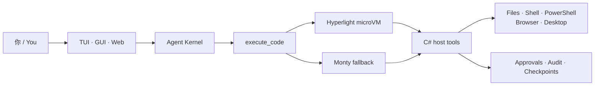

<div align="center">


# AllAgent.NET

**一个不再和 PowerShell 打架的 Windows 原生 AI Agent。**

CodeAct · Windows Computer Use · 随包 PowerShell 7.6 · TUI + GUI

[](https://github.com/luolangaga/AllAgent.NET/releases/latest)
[](https://www.nuget.org/packages/AllAgent.NET.Terminal)
[](https://www.nuget.org/packages/AllAgent.NET.Terminal)
[](https://github.com/luolangaga/AllAgent.NET/stargazers)
[](https://github.com/luolangaga/AllAgent.NET/issues)
[](#环境要求)
[](#从源码构建)
[](LICENSE)
[](#对比)
[](#对比)

[English](README.md) · **简体中文**

</div>

---

## AI 又在和 PowerShell 打架了

让传统 Agent 在 Windows 上做一件真实的事，它经常会吐出一段 100 行的 PowerShell 脚本：cmd 和 PowerShell 语法混在一起、忘了 `-ErrorAction`、带空格的路径引号写错、编码又出问题。然后它再写一段更长的脚本重试。每一次重试都在烧时间和 token。

这些 Agent 通常还有三个问题：

- **Windows 上没有原生的 Computer Use。** 它们停在 Shell，或者依赖脆弱的 Python 自动化。
- **还没开始干活，运行时先吃掉内存。** Electron/Node Agent 自带 Chromium 和 Node；Python Agent 再加一个解释器。
- **每一步都要一次 JSON 工具调用。** 复杂任务变成一长串模型往返。

AllAgent.NET 就是为了解决这四个问题而开发的。它是一个面向真实 Windows 工作流的 .NET Agent：CodeAct 编排、原生 Computer Use、随包 PowerShell 7.6 环境，以及共享同一套内核的 TUI 和 GUI。

## 对比

| 问题 | 传统 tool-calling Agent | AllAgent.NET |
|---|---|---|
| **复杂 Windows 任务** | 模型写长 PowerShell 脚本；引号和编码错误；反复重试 | 模型写一段 Python CodeAct 程序；类型化宿主工具完成 Windows 操作 |
| **复杂任务成本** | 每一步一次 JSON 工具调用；大量模型往返 | 一段编排程序；更少往返、更少 token |
| **Windows 自动化** | 通常没有，或依赖 Python `pyautogui` / `uiautomation` | 12 个 `computer_*` 工具（FlaUI / UIA3）+ 浏览器控制 |
| **PowerShell** | `powershell.exe -Command "..."` 字符串；编码问题 | .NET 进程内托管 + 随包 PowerShell 7.6 SDK；类型化对象 |
| **运行时占用** | Electron/Node + Python + 自带 Chromium | .NET 宿主 + 系统 WebView2 + 一份共享运行时 |
| **界面** | 只有聊天，或一个 IDE 插件 | TUI、GUI、Web 工作台共享同一套内核 |
| **Git 与终端** | 分散在多个应用 | 内置 Git 面板 + 集成终端 |
| **扩展** | 每个 MCP/工具带自己的认证和配置 | .NET 插件，通过 NuGet 分发 |

## 七个优势

### 一、CodeAct：一段 Python 程序，而不是一串 JSON 工具调用

正常 Agent 通过 JSON 调用工具。如果你让它读取一个文件、分析内容、再把结果保存下来，它可能需要三次或更多工具调用，也就是三次以上模型往返。

CodeAct 不一样：模型直接写一段 Python 程序，一次完成整个流程。这段程序不需要写成很复杂的 PowerShell 脚本，也不需要引入 Git Bash 或 POSIX Shell 来补语法，而是调用类型化的宿主工具完成真正的 Windows 操作：读文件、跑命令、写结果。模型负责编排，宿主负责副作用。

```
模型 → execute_code（Python 编排） → 宿主工具（C#） → Windows
```

这就是 CodeAct 存在的主要原因：

- **避免 AI 写复杂的 PowerShell。** 模型不再需要生成一段脆弱的 100 行脚本，把引号、编码、cmd/PowerShell 语法混在一起；路径和参数由宿主工具以数据形式接收。
- **减少复杂任务的 token 消耗。** 没有重复的 JSON 工具调用壳，没有塞进提示词/回复里的巨大 PowerShell 脚本，也少了引号错误导致的反复重试。
- **权限仍然只有一个收口。** 所有副作用都经过类型化的 C# 宿主工具，审批、路径规则和审计不会散落在各个工具里。

### 二、Windows Computer Use 和浏览器控制

大多数 Windows Agent 停在 Shell。原生桌面自动化需要 UIA/FlaUI 集成、窗口与会话管理、逐次动作审批，不是装一个 Python 包就能解决的。

AllAgent.NET 自带：

- **12 个 `computer_*` 工具**，基于 FlaUI / UIA3。
- **三种模式**：`background`（UIA 语义操作，不需要焦点）、`foreground`（物理键鼠）、`isolated`（独立 Windows 会话 Worker）。
- **浏览器控制**：内置 WebView2 或外置 Chrome/Edge，由 C# 实现。不需要 Python 浏览器库，也不需要额外下载 Chromium。
- **审批与审计**：桌面动作仍然走同一个宿主网关。

### 三、真正的 PowerShell 7.6 执行环境，由 .NET 托管

PowerShell 和本软件都是用 .NET 写的，这不是巧合：

- 随包携带一个几乎完整的 PowerShell 7.6.x 环境（含模块）。不需要系统预装 PowerShell，也不会回退到 PowerShell 5.1。
- PowerShell worker 在 .NET 进程里通过 `System.Management.Automation` 和 runspace 直接托管引擎。路径、参数、结果都是类型化对象，不经过 `powershell.exe -Command "..."` 的字符串重编码，经典的引号和编码问题自然消失。
- `powershell_script` 运行在具名持久会话里。变量、函数、导入和工作目录在调用之间保留。
- PowerShell 管理页可以搜索 PowerShell Gallery、安装模块、查看导入验证后的导出命令。

这就是“启动一个 PowerShell 进程，祈祷字符串能活下来”和“托管 PowerShell 引擎，交换类型化对象”的区别。

### 四、新手友好的 TUI 和 GUI，一起安装

你不需要在终端和桌面应用之间二选一：

- **TUI**：全屏终端、F1 常用操作、F2 模型选择、F3 会话、Ctrl+P 命令搜索、审批卡片、计划模式、后台会话。
- **GUI**：WPF + WebView2 原生窗口，共享同一份工作区、会话、权限和后台任务。
- **一个安装包**：Windows 安装包同时包含两者，可以创建两个快捷方式。
- **同一份数据**：关闭窗口即结束宿主；终端和 GUI 读取同一个工作区。

### 五、多种提供商支持

提供商层支持：

- OpenAI Chat / Responses
- Anthropic
- Gemini
- Ollama
- 兼容 OpenAI 协议的服务

提供商预设和 OpenAI 兼容端点覆盖 CommandCode、Codex、DeepSeek 等服务。按 F2，或用 `/providers`、`/model` 切换；终端会记住上次的选择。

### 六、完善的 Git 和终端集成

GUI/Web 工作台不只是聊天页：

- **工作区文件**：浏览、预览文件，并引用到对话里。
- **Git 管理**：暂存、提交、分支、提交图、贮藏、推送/拉取，以及 AI 生成提交信息。
- **集成终端**：ConPTY + xterm.js，多标签，刷新页面不中断。
- **TUI 对应能力**：`/diff`、`/undo`、`/redo`、`/checkpoints`、`@file` 引用。

### 七、插件扩展

插件是 .NET 包，不是另一套脚本层：

- 用 `[AgentTool]` 和 `[Description]` 注册工具。
- 通过插件的 `web` 块扩展 Web 工作台：页面、自定义工具卡、命令面板入口，运行在沙箱 iframe 里。
- 发布到 NuGet，或从插件管理器安装。
- 内置示例包括 CommandCode、GitHub、WorkBuddy、CodeGraph。

## 为什么选 .NET，而不是 Electron 或 Node

选 .NET 不是为了好看。它直接决定了运行时更小、PowerShell 集成更干净。

| 关注点 | Electron/Node Agent | AllAgent.NET |
|---|---|---|
| **UI 运行时** | 自带 Chromium + Node | .NET 宿主 + 系统 WebView2 |
| **Agent 宿主** | Node 进程 | .NET 进程 |
| **Worker** | 各自独立的运行时和进程 | 宿主与 worker 共享一份自包含 .NET 运行时 |
| **PowerShell** | 子进程 + 命令字符串 | 进程内 `System.Management.Automation` + runspace |
| **Windows API** | FFI / 原生扩展 | 直接用 C# 调 Win32 / COM / UIA |
| **部署** | 打包 Chromium、Node 和应用 | 一个自包含输出目录 |

具体意味着：

- **更低的内存基线。** Agent 宿主里没有自带 Chromium，也没有 Node 运行时；GUI 使用系统 WebView2；宿主和 worker 共享一份 .NET 运行时，而不是每个组件再起一套栈。
- **不用赌 PowerShell 的编码。** PowerShell 引擎托管在 .NET worker 里，参数以对象传递，不拼成命令行；带空格、Unicode、引号的路径不会被 Shell 二次解析。
- **原生 Windows 访问。** C# 可以直接调用 Win32、COM、UIA、WebView2、进程与作业对象；宿主工具、worker 和 GUI 外壳使用同一种语言。
- **自包含部署。** 终端宿主、GUI、浏览器、沙箱、PowerShell 和桌面 worker 在同一个输出目录里，共享一份运行时。

Python 仍然用于执行环境（3.10–3.14），但它不是 Agent 宿主。重点是不要在第一次任务之前就叠上 Electron + Node + Python + 自带浏览器。

## 架构总览



- **Agent Kernel**：微软 Agent Framework 控制循环、逐次授权网关、跨界面会话运行时和带范围的子任务交接。
- **CodeAct**：在 CodeAct 执行路径中，模型侧只有 `execute_code`。
- **沙箱**：Hyperlight 优先，Monty 兜底；都不可用时阻止执行。
- **宿主工具**：30+ 个 `[AgentTool]`，覆盖文件、搜索、Shell、PowerShell、浏览器、桌面、任务和计划。
- **数据层**：`DataStore` 是唯一历史写入者；原子替换、fsync、校验和回读、跨进程事务。

## 界面

### TUI


*TUI 命令总览（按 `allagent --help` 的实际命令整理）。全屏聊天、审批、计划、后台会话都在同一个终端里完成。*

### GUI 工作台


*GUI 工作台（演示数据）：工作区、模型配置、会话列表、权限模式、任务状态和输入框在同一个窗口内。*

### GUI Git 管理


*Git 管理（演示数据）：暂存、提交、分支、提交图、贮藏、推送/拉取，以及 AI 生成提交信息。*

> 截图展示当前中文界面。“演示数据”表示 GUI 页面通过内置 mock 传输渲染，用于展示布局和交互；连接本地宿主后显示真实工作区数据。TUI 图按实际 `allagent --help` 的命令整理。

## 快速开始

### 环境要求

| 项目 | 要求 |
|---|---|
| 系统 | Windows x64（Agent 执行目前只支持 Windows x64） |
| .NET | 源码构建需要 .NET 10 SDK；运行时要求 .NET 10 或更高 |
| Python | 3.10–3.14，需可执行；缺失或版本不符时按提示用 winget 安装 Python 3.13 |
| 虚拟化 | Hyperlight 需要硬件虚拟化与 Windows Hypervisor Platform；没有时自动使用 Monty |
| PowerShell | 无需单独安装，随包嵌入 PowerShell SDK 7.6.x，由独立 worker 运行 |
| ripgrep | 内容搜索依赖它，`allagent doctor --install` 可补齐 |
| Node.js / npm | 只有构建 React 前端时需要 |
| 图形界面 | 原生窗口需要 Microsoft Edge WebView2 Runtime |

### 安装

**Windows 安装包（推荐）**：从 [Releases](https://github.com/luolangaga/AllAgent.NET/releases) 下载 `AllAgent.NET-<版本>-win-x64-setup.exe`。安装时可以选择创建「终端」和「桌面端」两个快捷方式，并自动补齐 WebView2 运行时、Python 3.13 与 ripgrep；自包含发布，无需预装 .NET 运行时。详见 [Windows 安装包](docs/windows-installer.zh-CN.md)。

**通过 .NET Tool 安装**：

```powershell
dotnet tool install --global AllAgent.NET.Terminal
allagent --help
allagent doctor
```

升级或卸载：

```powershell
dotnet tool update --global AllAgent.NET.Terminal
dotnet tool uninstall --global AllAgent.NET.Terminal
```

从源码打包并用本地 NuGet 源安装的流程见 [.NET Tool 打包与安装](docs/nuget-tool.zh-CN.md)，本地构建 exe 安装包的流程见 [Windows 安装包](docs/windows-installer.zh-CN.md)。

### 首次运行

```powershell
allagent chat --workspace C:\Projects\MyProject
```

第一次进入聊天会初始化环境：内嵌 PowerShell SDK worker 实际启动自检，检查 ripgrep 与宿主 Python 版本，缺失时给出 winget 命令并在安装后提示重启。模型与扩展管理不需要启动沙箱，首次执行任务时才校验执行环境。离线或只改配置时可用 `--no-initialize` 跳过初始化。

### 配置模型

进入聊天后按 **F2** 选择提供商与模型，或用 `login` 登录受支持账号；`/providers edit 配置名` 编辑地址、Key、协议与参数，`/model` 随时切换。终端会记住上次的选择。

也可以临时用环境变量配置，不把 API Key 写进项目：

```powershell
$env:ALLAGENT_PROVIDER = 'openai'
$env:ALLAGENT_BASE_URL = 'https://api.openai.com/v1'
$env:ALLAGENT_MODEL = '<模型 ID>'
$env:ALLAGENT_API_KEY = '<你的 API Key>'
allagent chat --workspace C:\Projects\MyProject
```

### 图形界面与 Web 工作台

| 入口 | 行为 |
|---|---|
| `allagent -guimode` | 校验参数后派生一个隐藏宿主进程并立即返回，关闭窗口即结束 |
| `allagent gui` | 前台运行同一个窗口，Ctrl+C 结束；`--gui-url` 指向 Vite 开发服务器，`--gui-devtools` 打开窗口内开发者工具 |
| 聊天内 `/web-ui`（或 `allagent web-ui`） | 在浏览器打开 Web 工作台，与终端共享工作区、模型配置、权限和后台任务 |

```powershell
allagent -guimode
allagent gui --gui-url http://127.0.0.1:5173/
allagent web-ui
allagent web-ui --lan --port 8765 --password 你的密码
allagent web-ui --no-lan
```

需要手机或平板操作时，使用 `--lan`（聊天内为 `/web-ui --lan`）：宿主监听 `0.0.0.0`，在终端显示二维码，其他设备扫码即可进入。本机始终免密；其他设备默认通过二维码令牌进入，设置访问密码后也可以输入密码登录（外部页面始终显示密码框）。二维码令牌随服务重启失效。用 `--no-lan`（或 `--local`）可关闭局域网监听并记住该选择，避免下次启动再次对外监听；Web 设置页的「局域网访问与二维码」提供同样的开关、端口、密码和二维码。首次监听时 Windows 防火墙可能询问，请允许「专用网络」。

窗口是随包分发的 WPF + WebView2 外壳（`AllAgent.NET.Gui.exe`），同一数据目录只允许一个窗口。工作台页面包括对话、模型与 API、技能、工具、PowerShell、插件、MCP 服务、任务与设置；「PowerShell」页与终端的 `/powershell` 面板共享同一份模块目录。

## 权限模式与安全边界

| 模式 | 行为 |
|---|---|
| **restricted（默认）** | 工作区内的文件读写和可信 Shell 别名（`git`、`rg`、`dotnet`、`node`、`npm` 等，可用 `--allow-shell` 扩展）直接执行；工作区外的路径、未信任的程序以及 MCP / 桌面 / 插件工具仍逐次授权 |
| **full** | 宿主工具通常不再逐次审批，允许工作区外路径；沙箱隔离仍然生效，且不授予管理员权限 |
| **ask** | 逐次审批，工作区内的写入也要询问。审批卡片默认选中「允许这一次」，`Enter` 确认、`Y` 允许、`N` 或 `Esc` 拒绝、`A` 记住该目录 |
| **plan** | 只做只读调研；模型通过 `plan_propose` 提交 Markdown 计划，TUI 以 Markdown、Web 以 HTML 审批卡片显示。批准后自动切换到完全访问并在同一回合开始执行，拒绝则继续修订 |
| **simple** | 只保留 `powershell_script`、`file_read`、`file_edit` 三个宿主工具；技能、MCP、子代理、插件、浏览器与桌面工具停用 |

关键边界：

- 模型通过 `execute_code` 组织动作；文件、网络和进程操作全部由宿主工具完成，模型不能直接调用它们。
- `run_shell` 只接受可信列表中的程序，程序路径与参数分别传入，不拼接命令字符串。
- 获准运行的程序仍具有当前用户的权限；沙箱不隔离已批准的 Shell 或 MCP 进程，也不会撤回它们产生的副作用。
- `/undo` 只能撤回带检查点的文件工具修改，不能撤回 Shell、MCP 或工作区外的副作用。
- 审批、审计与工具结果写入项目数据目录；请求会把任务所需内容发送给所选模型服务，提 Issue 前请移除密钥与个人数据。

## 日常使用

### 常用快捷键

| 操作 | 快捷键 |
|---|---|
| 切换模型 | F2、`/model` |
| 打开常用操作 | F1 |
| 选择或恢复会话 | F3、`/session` |
| 搜索全部命令 | Ctrl+P |
| 引用项目文件 | `@路径`，路径含空格用 `@"路径"` |
| 输入多行 | Ctrl+J、Shift+Enter |
| 搜索输入历史 | Ctrl+R |
| 显示或隐藏侧栏 | Ctrl+B |
| 粘贴文本或截图 | Ctrl+V、Shift+Insert |
| 停止当前任务 | Esc |
| 退出 | `/exit`、Ctrl+D、空输入时按两次 Ctrl+C |

### 常用命令

| 命令 | 用途 |
|---|---|
| `/model`、`/models`、`/providers` | 切换模型、查看可用模型、管理提供商配置 |
| `/permissions restricted\|ask\|full\|plan\|simple`、`/plan` | 切换权限模式 |
| `/sandbox status\|auto\|hyperlight\|monty` | 查看或切换沙箱 |
| `/new`、`/session`、`/branch`、`/fork`、`/timeline` | 新建、恢复、复制与定位历史 |
| `/compact`、`/context`、`/stats`、`/cache` | 总结较早上下文、查看占用与累计 Token 用量、缓存策略 |
| `/diff`、`/undo`、`/redo`、`/checkpoints` | 查看文件修改、撤回与重做 |
| `/background`、`/tasks`、`/steer`、`/queue` | 后台任务、结果与授权、步骤边界指导、排队输入 |
| `/agents`、`/subagents`、`/parent`、`/children` | 子代理配置与父子会话切换 |
| `/skills`、`/plugins`、`/mcp`、`/hooks`、`/powershell` | 技能、插件、MCP、生命周期 Hook 与 PowerShell 能力 |
| `/browser`、`/computer` | 浏览器操作与桌面操作开关 |
| `/tools`、`/status`、`/doctor` | 工具契约、当前状态、环境检查 |
| `/help all` | 查看全部内置命令 |

## 数据与迁移

### 目录规则

| 内容 | 默认位置 |
|---|---|
| 项目数据（清单、会话、任务、审计 `audit.jsonl`） | `<工作区>/.allagent/data/` |
| 覆盖项目数据目录 | `--data-dir <路径>` |
| 工作区到数据目录的映射 | 程序目录下的 `allagent-projects.json` |
| 插件、OAuth 凭据、用户技能、共享运行时 | `%APPDATA%\AllAgent.NET`（显式指定 `--data-dir` 时改用该目录） |
| 日志 | `%APPDATA%\AllAgent.NET\allagent.log` |

用户目录下的外部技能只自动扫描 `~/.agents/skills/`；AllAgent.NET 自身技能目录和项目级技能按原规则加载。

### 清单与修订

`allagent.json` 是 v3 清单/设置文件，每个会话的不可变修订单独保存在 `conversations/`，保存当前会话不会重写其他历史。写入使用原子替换、fsync 与校验和回读，保留主清单与备份清单引用的会话版本；坏文件不会被静默替换成空数据库。

### 旧数据迁移

首次为某个工作区建立项目数据目录时，会自动导入旧 AppData 数据库中属于该工作区的会话，以及未记录工作区的旧会话和配置，旧目录保持可恢复。旧版单文件数据库在写入时转换为拆分格式，并保留 `allagent.legacy-v2.json.bak`。旧版本程序不支持新格式，请用新版本读取。

## 从源码构建

### 开发环境

```powershell
# 完整开发环境（Vite + 原生窗口）
.\dev.ps1

# 只编译终端宿主，跳过 Web 构建
dotnet build src/AllAgent.NET.Terminal -p:SkipWebBuild=true

# 默认先 npm run build，再把 dist/ 拷到宿主旁边的 web/
dotnet build src/AllAgent.NET.Terminal
```

### Web 前端

```powershell
npm --prefix src/AllAgent.NET.Web install
npm --prefix src/AllAgent.NET.Web run dev

cd src/AllAgent.NET.Web
npm run build      # tsc --noEmit && vite build，产物在 dist/
npx tsc --noEmit   # 只做类型检查
npm test           # vitest run
```

### 测试与发布

```powershell
dotnet test tests/AllAgent.NET.Tests

# 发布 Windows x64 自包含版本
dotnet publish src/AllAgent.NET.Terminal -c Release -r win-x64 --self-contained true -o artifacts/allagent-win-x64
```

发布后请保留整个输出目录：终端宿主与各 worker（`AllAgent.NET.Gui.exe`、`AllAgent.NET.Browser.exe`、`AllAgent.NET.ComputerUse.exe`、`AllAgent.NET.Sandbox.exe`、`AllAgent.NET.PowerShell.exe`）同目录共享一份运行时，另有 `Modules/`、`web/`、`everything/` 与 `builtin-plugins/`；缺少 `AllAgent.NET.PowerShell.exe` 或 `Modules/` 时需重新安装或修复工具包。`AllAgent.NET.Core` 可嵌入其他 .NET 应用，扩展工具用 `[AgentTool]` 和 `[Description]` 注册，生成器产出 `IAgentToolSet`。

### 解决方案结构

| 项目 | 职责 |
|---|---|
| `src/AllAgent.NET.Core` | UI 无关的 Agent 引擎、模型服务、数据存储、桥接与技能 |
| `src/AllAgent.NET.Terminal` | Spectre.Console 终端宿主（`chat`、`web-ui`、`-guimode`） |
| `src/AllAgent.NET.Gui` | WPF + WebView2 原生窗口外壳，不依赖 Core |
| `src/AllAgent.NET.Web` | React 19 + Iconiq UI + Vite 5 + TypeScript 聊天界面 |
| `src/AllAgent.NET.Sandbox` | Hyperlight 隔离执行 worker，随包与宿主同目录 |
| `src/AllAgent.NET.PowerShell` | 嵌入的 PowerShell SDK worker，随包与宿主同目录（模块在 `Modules/`） |
| `src/AllAgent.NET.Browser` | C# 浏览器运行时（WebView2 与外置浏览器） |
| `src/AllAgent.NET.ComputerUse` | 基于 FlaUI 的桌面操作 worker |
| `src/AllAgent.NET.ToolGenerator` | Roslyn 增量生成器：JSON Schema 与类型化分发 |
| `tests/AllAgent.NET.Tests` | xUnit：工具边界、Agent 生命周期与实际微虚拟机测试 |

## 常见问题与排错

| 现象 | 处理 |
|---|---|
| 不确定缺什么环境 | `allagent doctor`（聊天内 `/doctor`）看检查表；`doctor --install` 在确认后装依赖 |
| 内容搜索不可用 | 安装 ripgrep：`winget install --id BurntSushi.ripgrep.MSVC` |
| 提示宿主 Python 缺失或版本不符 | 需要 3.10–3.14；按提示用 winget 安装 Python 3.13，安装后重启软件 |
| 沙箱启动失败 | `/sandbox status` 查看实际后端与兜底原因；没有虚拟化时用 `/sandbox monty` |
| PowerShell 工具报 worker 缺失 | worker 随包分发，报缺失说明安装损坏，重新安装 AllAgent.NET |
| 模型连不上 | `/login status` 查看账号与连接状态，`/providers show 配置名` 查看脱敏配置 |
| 需要查看日志 | `%APPDATA%\AllAgent.NET\allagent.log`，其中包含 `[Gui]`、`[GuiHost]` 与桥接调用记录 |

## 更多文档

- [架构与迁移](docs/agent-architecture.zh-CN.md) · [系统提示词](docs/agent-prompts.zh-CN.md) · [派发合同](docs/subagent-contract.zh-CN.md) · [验收报告](docs/agent-kernel-validation.zh-CN.md)
- [按需工具披露](docs/on-demand-tools.zh-CN.md)
- [CodeAct 与 Hyperlight 接入](docs/codeact.zh-CN.md)
- [Python 执行过程与权限模式](docs/execution.zh-CN.md)
- [宿主文件与命令工具](docs/host-tools.zh-CN.md)
- [文件搜索与工具输出](docs/file-search.zh-CN.md)
- [内置 Browser Use](docs/browser-use.zh-CN.md) · [Windows Computer Use](docs/computer-use.zh-CN.md)
- [PowerShell 持久会话](docs/powershell-session.zh-CN.md) · [PowerShell 能力商店](docs/powershell-store.zh-CN.md)
- [子代理独立配置](docs/subagent-configuration.zh-CN.md) · [自定义代理角色示例](docs/agent-roles.example.json)
- [Web 工作台：文件浏览、Git 管理与集成终端](docs/webui-files-git-terminal.zh-CN.md)
- [.NET Tool 打包与安装](docs/nuget-tool.zh-CN.md)
- [插件开发指南](docs/plugins.zh-CN.md) · [插件开发入门](docs/plugin-development-beginner.zh-CN.md) · [插件 Web 前端扩展](docs/plugin-web-ui.zh-CN.md)

## 许可证

本项目采用 **GPL-3.0-only** 开源协议。

- 源代码可自由使用、修改和分发
- 衍生作品必须以相同协议开源
- 详见 [LICENSE](LICENSE)；第三方代码的声明与许可证见 [THIRD-PARTY-NOTICES.md](THIRD-PARTY-NOTICES.md)

---

<div align="center">

欢迎通过 [Issues](https://github.com/luolangaga/AllAgent.NET/issues) 报告问题或提出建议。提交改动时请说明复现步骤、行为变化与验证方式；环境或沙箱问题请附上 `doctor` 输出，并移除密钥和个人数据。

**如果觉得有用，给个 Star 吧！**

<sub>Windows x64 · .NET 10 · GPL-3.0-only</sub>

</div>
