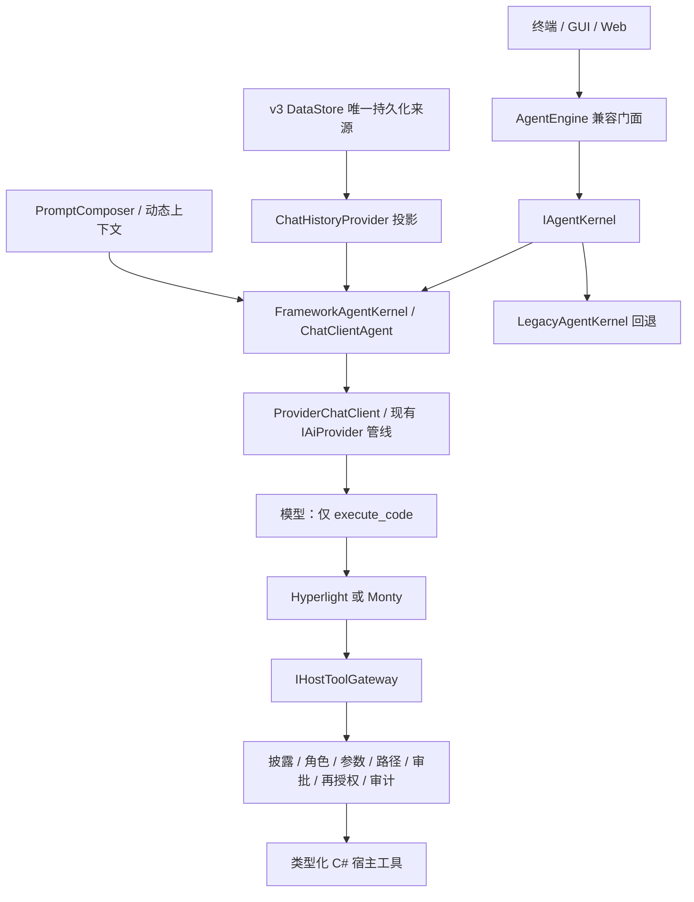

# Agent 内核与执行边界

本次改造保留现有 `AgentEngine`、`IAiProvider`、插件、MCP、桥接协议和 v3 数据。内核通过 `IAgentKernel` 切换；模型仍然只看到 `execute_code`。

## 微软文档与设计取舍

核对日期：2026-10-19。Core 使用 `Microsoft.Agents.AI 1.24.0`；Hyperlight worker 继续使用仓库锁定的 `Microsoft.Agents.AI.Hyperlight 1.24.0-preview.261006.1`。Hyperlight 集成仍为预览依赖，不能把版本号相近理解为所有 .NET 能力都已正式发布。

| 依据 | 在本项目中的落实 |
|---|---|
| [Agent pipeline](https://learn.microsoft.com/en-us/agent-framework/concepts/agents/agent-pipeline) | `ChatClientAgent`、历史投影、动态上下文与模型适配分离 |
| [CodeAct](https://learn.microsoft.com/en-us/agent-framework/agents/code-act) | 单一模型工具、代码编排宿主函数、按实际运行时披露能力 |
| [Hyperlight](https://learn.microsoft.com/en-us/agent-framework/integrations/by-component/context-providers/hyperlight) | 官方 `HyperlightExecuteCodeFunction` 放在独立 worker；宿主函数自行授权 |
| [Monty](https://learn.microsoft.com/en-us/agent-framework/integrations/by-component/context-providers/monty) | 保留解释器后备方案，明确它与硬件隔离和完整 CPython 的区别 |
| [AIContextProvider](https://learn.microsoft.com/en-us/dotnet/api/microsoft.agents.ai.aicontextprovider?view=agent-framework-dotnet-latest) | 注入内容由应用校验，不能假定框架自动识别不可信指令 |
| [Handoff 与 Agent-as-Tools](https://learn.microsoft.com/en-us/agent-framework/workflows/orchestrations/handoff) | 子代理返回结果，主代理继续负责总体目标，不转移最终责任 |
| [CodeAct 原始研究](https://github.com/xingyaoww/code-act) | 代码作为组合动作语言，不等于把宿主权限交给任意 Python |

微软的 .NET CodeAct 宿主回调不会自动获得所有外层函数中间件的保护。本项目保留逐次函数授权，不能用一次 `execute_code` 审批替代内部每次文件、进程和外部服务调用的授权。也没有宣称启用 .NET 尚不支持的 FIDES CodeAct 保证。

## 控制流



`FunctionInvokingChatClient` 接管正常的模型→代码工具→模型循环。外层协调器只处理输入接纳、输出截断续写、必需子结果和终止状态。原生 provider 流继续直接产生现有 UI 事件，图片、签名推理、认证、请求缓存及用量由现有管线处理。SDK 收到工具循环需要的消息投影；持久化原生消息保留完整 provider 状态，不能从有损投影反向覆盖它们。

`DataStoreChatHistoryProvider` 不另存一份框架聊天历史。每次模型响应和工具结果先写入原有 DataStore，再推进下一次模型请求。输入只接纳一次。模型切换时继续清理不兼容的原生状态，重试不得重放已完成的宿主操作。

## 运行时与视图生命周期

`ConversationRuntimePool` 按规范化数据目录管理引用计数；同一池内再按工作区绝对路径和会话 ID 取运行时。终端、Web、GUI 后端及子代理使用同一个工厂实现。同一会话跨界面复用沙箱、PowerShell 会话和披露状态，其他会话得到独立实例。角色名不再充当运行时缓存键。

视图关闭或切走不代表运行取消。关闭一个服务只取消它拥有的运行、释放它的池引用；最后一个持有者离开后才释放底层运行时。运行中的会话禁止被另一个视图重新注册工具或重配运行时。删除会话前也必须先停止其运行。

每个请求边界刷新指令和角色表。每次工具调用刷新权限、只读限制、角色工具约束和任务范围。等待审批时保存授权版本；执行前重新检查，变化时拒绝旧调用。静态资源、后端、工具预算和环境配置变化会使空闲运行时重新创建；同一实例内的新回调不会继续引用上一次请求的配置。

Hyperlight worker 连续空闲五分钟后释放，下次调用重新启动同一已选后端。Monty worker 本来就按次启动和结束。只缓存成功的环境检查五分钟；工具目录查询使用元数据构造，不启动 VM、PowerShell 探针或联网安装。

## 工具网关与预算

模型来源的调用统一经过 `CodeActProvider.CallToolAsync` 和 `IHostToolGateway`。注册和披露分离：未披露的工具仍在宿主注册表中，但调用会被拒绝并告知所属技能；成功 `skill_read` 后只更新当前会话的工具表，不重启微虚拟机。

实际执行依次检查：会话上下文、子代理能力、角色允许表、披露、参数结构、任务范围与工具预检、路径授权、逐次审批、角色授权及最新策略。Full 模式也不能覆盖只读角色、派发合同或父授权上限。审计保存会话 ID、运行 ID、宿主调用 ID、父代码调用 ID、参数哈希和结果状态；不复制命令参数、文件正文和凭据。

| 预算 | 默认边界 |
|---|---|
| IPC 完整帧 | UTF-8 16 MiB |
| 单个宿主调用的累计分块参数 | UTF-8 16 MiB |
| IPC JSON 深度 | 64 |
| 交给 guest 的宿主结果 | 16 MiB；超限明确说明先前操作可能已完成 |
| 工具界面预览 | 原有 64,000 字符，流预览 20,000 字符，可配置 |
| guest stdout | 原有 20,000 字符 |

结果在 guest 聚合之前不再按界面预览预算截断。`ToolResult` 原字段保留，并可附加 `sandbox`、`hostCallSummary` 等证据。协议携带版本、执行 ID、宿主调用 ID，并验证请求/响应状态。Windows worker 使用原始字节管道读取帧，避免 `Console.In` 分块读取等待缓冲区填满而卡住。

## 后端切换和成功语义

Auto 只在首次准备阶段允许 Hyperlight→Monty 回退。准备完成后即固定所选后端；执行错误、超时和 native 崩溃不得自动切换或重放代码。坏掉的 Hyperlight worker 会被丢弃，下一次调用可以在同一后端启动新 worker。宿主操作已产生的副作用不会因 guest 失败回滚。

必须区分四件事：Python 执行完成、某次宿主调用成功、子代理正常结束、用户需求通过验收。`execute_code.ok=true` 不代表内部所有宿主调用成功；子代理退出码 0 也不能替代真实文件与验证证据。

## 迁移入口

内部迁移开关：

```powershell
# 产品默认使用框架内核
allagent run '你的任务'

# 临时切到旧控制循环；不回退宿主权限修复和数据保护
$env:ALLAGENT_AGENT_KERNEL = 'legacy'
allagent run '继续任务'

# 恢复产品默认
Remove-Item Env:ALLAGENT_AGENT_KERNEL
```

无效值会直接报错。产品默认使用 `framework`；旧内核保留一个发布周期用于回退，切换无需迁移或复制会话文件。嵌入宿主也可以设置 `AgentOptions.AgentKernel`，环境变量优先。默认启用状态和实际测试数据见[验收报告](agent-kernel-validation.zh-CN.md)。

更多内容：[提示词](agent-prompts.zh-CN.md)、[派发合同](subagent-contract.zh-CN.md)、[按需工具](on-demand-tools.zh-CN.md)。
